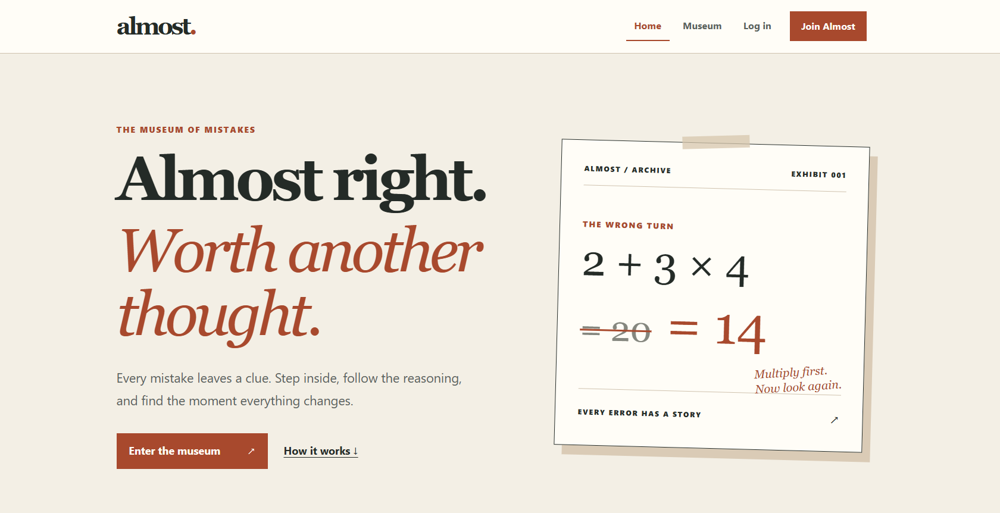

# All Most

### Almost right. Worth another thought.

**All Most** is an interactive Museum of Mistakes built around one idea: a wrong answer can be the start of real understanding. Students explore an intentionally incorrect solution, find where the thinking went wrong, and reveal the explanation. Teachers turn common misconceptions into exhibits and see anonymous patterns in student answers.



> **Demo theme:** Imagine education in the future. What if mistakes became exhibits we could explore and repair together?

## The experience

1. **Enter the museum.** Browse topic rooms and published exhibits. The demo includes Math and JavaScript.
2. **Follow a wrong turn.** Read a question and an incorrect solution, then choose where the reasoning failed.
3. **Get the “aha” moment.** See feedback for your choice, the correct diagnosis, and the explanation. Your first answer is saved; you can try again for practice without changing it.
4. **Try Fix the AI.** In the JavaScript room, choose between teacher exhibits and a short code challenge. Find the AI's mistake by selecting an explanation or correcting one line of code.
5. **Create from the teacher side.** Teachers write exhibits, preview and publish them, and learn from anonymous answer summaries.

## Features

| Area | What it does |
| --- | --- |
| Museum | Shared topic rooms with published teacher exhibits; visitors can browse without signing in. |
| Student attempts | Saves the first answer per student and exhibit version, then reveals choice-specific feedback and the explanation. Later tries are practice only. |
| Teacher Studio | Create, edit, preview, and delete drafts; publish, archive, and restore exhibits; see anonymous aggregate results for owned exhibits. |
| Fix the AI | Requests a short JavaScript challenge from the backend. Users choose the mistake or correct one line, then receive an explanation. A reviewed challenge can be used when live generation fails. |
| Accounts | Student or teacher registration, login, profile, sign out, and email password reset when SMTP is configured. |
| Feedback | In-app notifications and confirmation dialogs for important actions. |

**Demo scope:** The museum is shared across users. There are no classes, student-submitted exhibits, teacher review queues, or teacher identity verification in this version. A user selects Student or Teacher at registration.

## How the AI challenge works

The browser requests a challenge from the Express API. The server calls the OpenAI API and validates the generated challenge against the expected short code pattern. If generation is unavailable or fails validation, the server may provide a reviewed challenge and labels it accordingly.

The server checks answers. Code typed by students is compared as text and **never executed**. The OpenAI key stays on the backend.

## Tech stack

- **Frontend:** React, React Router, Vite, CSS, React Toastify
- **Backend:** Node.js, Express
- **Database:** MongoDB Atlas with Mongoose
- **AI:** OpenAI API through the backend
- **Authentication:** Session cookie and role-based API access

## Run locally

You need Node.js and npm, a MongoDB connection string, and access to the Atlas cluster from your current IP.

From the repository root, install dependencies:

```bash
npm install
```

Create `apps/api/.env` and set your own values:

```dotenv
PORT=5000
MONGODB_URI=your_mongodb_connection_string
AUTH_SECRET=your_random_secret_of_at_least_32_characters
APP_URL=http://localhost:5173

# Required for live Fix the AI challenges:
OPENAI_API_KEY=your_openai_api_key

# Required for password-reset emails:
SMTP_HOST=your_smtp_host
SMTP_PORT=587
SMTP_SECURE=false
SMTP_USER=your_smtp_username
SMTP_PASS=your_smtp_password
MAIL_FROM=your_sender_email
```

`MONGODB_URI`, `AUTH_SECRET`, and `APP_URL` are required to start the API. Without an `OPENAI_API_KEY`, the Fix the AI endpoint is unavailable. Without SMTP settings, password-reset email cannot be sent. Never commit `.env` or put server secrets in frontend environment variables.

Start the web app and API together:

```bash
npm run dev
```

- Web app: [http://localhost:5173](http://localhost:5173)
- API health: [http://localhost:5000/api/health](http://localhost:5000/api/health)

The frontend calls relative `/api` URLs. During local development Vite forwards those requests to the API, so both processes need to be running.

For a fresh database, add the demo rooms and exhibits:

```bash
npm run seed:rooms --workspace apps/api
npm run seed:exhibits --workspace apps/api
```

## Useful commands

| Command | Purpose |
| --- | --- |
| `npm run dev` | Start frontend and API in development mode. |
| `npm run build` | Build the frontend into `apps/web/dist`. |
| `npm run seed:rooms --workspace apps/api` | Add demo museum rooms. |
| `npm run seed:exhibits --workspace apps/api` | Add demo exhibits. |

## Project structure

```text
apps/
  api/
    src/
      config/       Database connection
      middleware/   Authentication
      models/       MongoDB models
      routes/       API routes
      scripts/      Demo seed scripts
  web/
    src/
      components/   Shared UI
      pages/        Museum, auth, teacher, and AI screens
      services/     API requests
      styles/       Global design tokens and styles
docs/
  requirements/     Current product scope and flows
```

## Deployment note

`npm run build` produces a static frontend in `apps/web/dist`. Netlify can host that frontend, but **Netlify alone does not start the Express API or connect it to MongoDB**. For an online demo, host the API separately, configure its environment variables, and route the frontend's `/api` requests to it. Set `APP_URL` to the public HTTPS frontend origin and configure MongoDB Atlas access for the API host.

---

Built for the **“Imagine education in the future”** challenge. Every mistake is a clue.